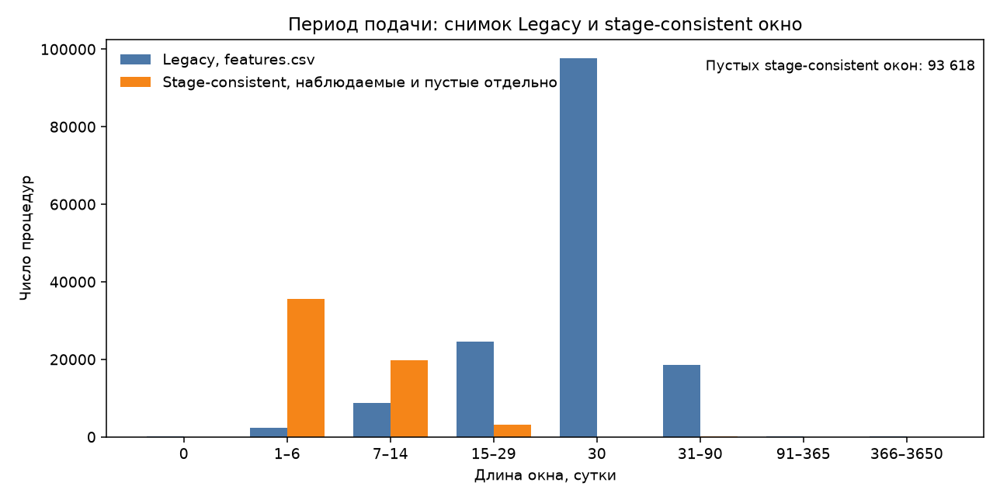
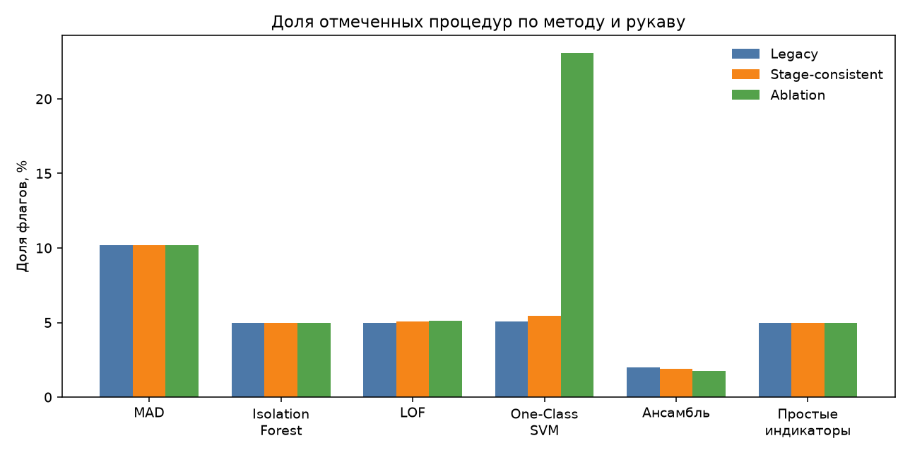
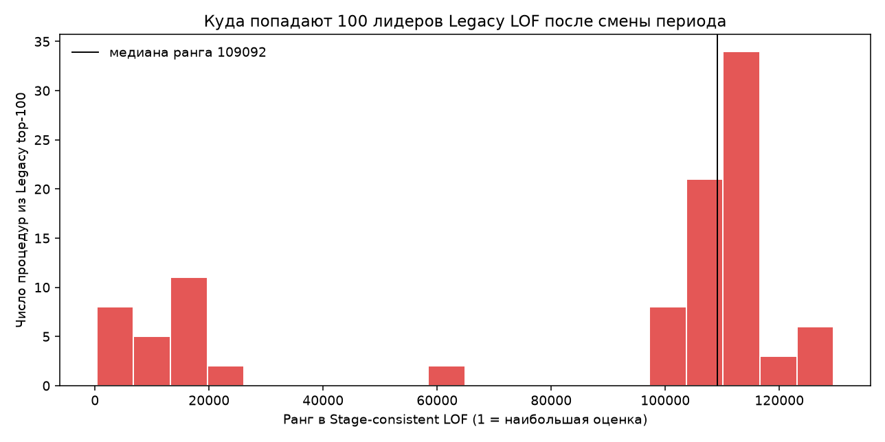

# Экспериментальный раздел главы 3. Период подачи и устойчивость детекторов

Раздел фиксирует проверенные результаты MTA-0024 и MTA-0025. Проверка MTA-0026 подтвердила числа по сохранённым файлам и повторным запуском с тем же зерном. Оценка детектора здесь — необычность процедуры относительно остальных строк корпуса. Она не является установленным нарушением и не доказывает коррупцию. Ансамбль не объявляется лучшим методом: ниже измерена устойчивость порядка при смене формулы периода.

## 1. Состав исследовательского корпуса

Единица анализа — одна процедура, ключ `ocid`. Локальный архив `data/raw/ocds_packages` содержит 152 378 пакетов `*.json.gz`. Ошибок чтения нет. Снимок признаков `data/features/features.csv` содержит те же 152 378 уникальных OCID. SHA-256 файла `9e26782375476571ea770935582c3cee1c286f71cde4ad97ec96d81d3d8d92f7` совпадает с манифестом экспорта, сверенным в MTA-0022. Соединение пакетов и снимка полное: строк только в одном источнике нет.

Это современный снимок compiled releases, полученный при локальной загрузке, а не архив версий на момент первой публикации. MTA-0022 не сертифицировал ни одного значения периода на t0 для восьми проверенных процедур. Поле `historically_certified` в новой таблице равно 0 во всех 152 378 строках. Этот статус раздел не меняет.

## 2. Смешение стадий PN и EV

Длина периода в снимке считается после `merge_compiled_releases`. Слияние оставляет первое непустое значение. На этом корпусе старт `tenderPeriod` часто принадлежит planning notice, а конец — evaluation notice. Это разные стадии одной процедуры, а не две версии одного извещения.

Полная пара evaluation, обе границы которой неотрицательны и единственны, есть у 58 760 процедур (38,56%). У 93 618 процедур (61,44%) evaluation record в пакете нет. Других статусов нет: неполных, конфликтующих, отрицательных и неразборных evaluation-пар в снимке ноль.

Смешанное окно после старого слияния отмечено у 58 759 процедур. Из 58 760 полных evaluation-окон не смешаны только две: `ocds-b3wdp1-MD-1703678445874` и `ocds-b3wdp1-MD-1712223575963`, у обеих обе границы уже из evaluation. Ещё одна смешанная строка, `ocds-b3wdp1-MD-1643538664394`, соединяет planning и base и полного evaluation-окна не имеет.

Там, где можно сравнить два неотрицательных числа, старое окно длиннее evaluation-окна в 53 621 процедуре, короче в 2 183 и совпадает в 340. Ещё у 2 616 процедур с полным evaluation-окном смешанный span отрицателен: старт из planning позже конца evaluation. Действующая нормализация тогда отбрасывает конец, а формула признака подставляет 30 суток. Новая длина при этом существует.

Восемь процедур MTA-0022 прочитаны повторно из исходных JSON. У каждой смешанное окно соединяет PN.start с EV.end, а окно одной evaluation record совпадает с ранее опубликованной диагностической длиной.

## 3. Исправленная методика признаков

Stage-consistent окно записывается только для одной полной неотрицательной пары `startDate` и `endDate` из evaluation. Длина — `floor` разности в сутках после разбора UTC, то есть то же правило, что `Series.dt.days`. Пропуск остаётся пропуском. Константа 30 в таблицу не пишется. Planning start не подставляется вместо evaluation start. Для шкалы детекторов длина сверху ограничена 3650 сутками; таких строк на корпусе нет.

`short_deadline` равен 1, когда наблюдаемое окно короче 7 суток. `long_deadline` равен 1, когда оно длиннее 90 суток. Если окна нет, оба флага пусты. В снимке `short_deadline` равен 1 у 2 661 процедур (1,75%). Среди наблюдаемых evaluation-окон короче 7 суток 35 554, то есть 60,51%. Длиннее 90 суток — 8 наблюдаемых окон против 171 флагов в снимке.

Наблюдаемые окна имеют минимум 0, нижний квартиль 3, медиану 5, среднее 6,68, верхний квартиль 8 и максимум 328 суток. Короткий срок после исправления — центр наблюдаемого распределения. Прежняя редкость получена после смешения стадий и после подстановки 30.

В снимке значение ровно 30 имеют 97 617 процедур (64,06%). Все 93 618 процедур без evaluation-окна входят в это число. Настоящих тридцатидневных evaluation-окон 23, и ни одно из них не хранится в снимке как 30. Литерал 30 в `bid_window_days` этого файла не является множеством тридцатидневных сроков подачи.

Рисунок 1 построен по корзинам `quality.json`: синие столбцы — `bid_window_days` снимка, оранжевые — stage-consistent длина. 93 618 пустых новых окон на столбец «30» не отнесены.

*Источник: `results/mta0024_stage_periods/quality.json`, корзины `bins_legacy_feature_bid_window` и `bins_stage_clipped_window`. Пустые stage-consistent значения вынесены в подпись, а не в корзину 30.*

В матрицу детектора stage-consistent рукава пропуск непрерывной длины заменяется медианой наблюдаемых окон. На этом корпусе медиана равна 5 суткам. Рядом добавляется индикатор `submission_window_missing`. Эта пятёрка — вход модели для 93 618 строк без измерения. В таблицу признаков она не записывается и с константой 30 не совпадает.

## 4. Три экспериментальных варианта

Сравнение идёт на одном списке из 152 378 OCID, отсортированном по идентификатору. Период отличается от legacy-признака или отсутствует при заполненном legacy-значении у 152 038 процедур. Неизменных значений 340.

| Рукав | Матрица детектора | Столбцов |
|---|---|---:|
| Legacy | 22 столбца снимка `features.csv`. Окно уже заполнено константой 30 внутри снимка. Оставшийся пропуск заменяется нулём, как в `scripts/06_detect_anomalies.py` | 22 |
| Stage-consistent | Те же непериодные столбцы. Три столбца периода заменены окном одной evaluation-стадии. В матрице детектора пропуск длины равен медиане 5 и отмечен индикатором пропуска | 23 |
| Ablation | Те же строки без `bid_window_days`, `short_deadline` и `long_deadline` | 19 |

Ablation не измеряет срок третьим способом. Она показывает, какая часть порядка сохраняется без этого семейства.

Препроцессинг геометрических моделей — `StandardScaler`, обученный на строках своего рукава. Зерно 42. Допущение contamination и параметр `nu` равны 0,05. Это настройка протокола, не оценённая доля нарушений. Административные метки ANSC и AAP в подбор параметров, в обучение и в выбор порогов не входили. Поиск по коду скриптов 55–58 не находит чтения этих меток.

## 5. Четыре детектора, ансамбль и простой счёт

Протокол повторяет `scripts/06_detect_anomalies.py`.

MAD — максимум устойчивого z-score по столбцам с ненулевым MAD. Флаг: z > 5. Бинарные столбцы, столбцы с MAD = 0 и spike-like столбцы в z-score не входят.

Isolation Forest — 300 деревьев, contamination 0,05, то же зерно. Оценка — минус `score_samples`. Флаг — `predict == -1`.

LOF — 20 соседей, `novelty=True`. Обучение на 20 000 случайных строках без возвращения. Префикс выборки не используется: порядок OCID связан со временем публикации.

One-Class SVM — ядро RBF, `nu` 0,05, `gamma=scale`, та же обучающая выборка. Оценка — минус `decision_function`. Флаг — `predict == -1`.

Ансамбль имеет две разные величины. Оценка для ранжирования — среднее четырёх внутрирукавных перцентильных рангов MAD, Isolation Forest, LOF и SVM. Флаг — не меньше трёх флагов из этих четырёх. Жаккар ниже считается по флагам. Top-K и Спирмен считаются по оценкам. Ничья в top-K разрешается меньшим OCID.

Простые индикаторы — отдельный baseline. Счёт равен числу следующих бинарных признаков, равных единице: `multi_award_tender`, `single_bidder`, `no_bid_data`, `multi_supplier_award`, `short_deadline`, `long_deadline`, `amended`, `accelerated_like`, `cancelled`, `no_award_after_tender`. Пропуск срока счёта не увеличивает. Индикатор отсутствия окна в счёт не входит. Флаг — ровно верхние 5% после разрешения ничьих по OCID, 7 619 строк в каждом рукаве. Это соглашение отчёта, не калиброванный порог. На корпусе счёт принимает пять целых значений от 1 до 5.

| Метод | Legacy | Stage-consistent | Ablation |
|---|---:|---:|---:|
| MAD | 15 529 (10,19%) | 15 529 (10,19%) | 15 529 (10,19%) |
| Isolation Forest | 7 618 (5,00%) | 7 563 (4,96%) | 7 619 (5,00%) |
| LOF | 7 606 (4,99%) | 7 720 (5,07%) | 7 810 (5,13%) |
| One-Class SVM | 7 740 (5,08%) | 8 321 (5,46%) | 35 171 (23,08%) |
| Ансамбль, не меньше трёх флагов | 3 031 (1,99%) | 2 873 (1,89%) | 2 700 (1,77%) |
| Простые индикаторы, верхние 5% | 7 619 (5,00%) | 7 619 (5,00%) | 7 619 (5,00%) |

*Источник: `results/mta0025_closed_experiment/experiment_summary.json` и файлы `scores_*.csv.gz`. Доля — число флагов, делённое на 152 378.*

*Источник: те же файлы. Меньшая доля ансамбля следует из правила «три из четырёх» и не означает более высокое качество.*

Внутри каждого рукава четыре детектора согласованы слабо. В Legacy Спирмен MAD и Isolation Forest равен 0,367, а Жаккар их флагов равен 0,119. Спирмен LOF и One-Class SVM отрицателен: −0,114 в Legacy, −0,168 в Stage-consistent, −0,104 в Ablation. Отрицательная корреляция означает противоположное направление двух шкал. Она не выбирает из них верную.

## 6. Устойчивость ансамблевого ранжирования

Для ансамбля Legacy и Stage-consistent Спирмен равен 0,943, Жаккар флагов равен 0,519. Вместе отмечены 2 016 процедур, только Legacy — 1 015, только Stage-consistent — 857. Пересечение top-100 равно 0,490, top-1000 равно 0,760. Медиана абсолютного разрыва перцентильных рангов равна 0,029.

Жаккар здесь — `|A ∩ B| / |A ∪ B|` по бинарным флагам. При пустом объединении функция возвращает 1; в этих сравнениях объединение непусто. Top-K — доля общих OCID среди K наибольших оценок.

| Метод | Спирмен | Жаккар флагов | Top-100 | Top-1000 |
|---|---:|---:|---:|---:|
| MAD | 1,000 | 1,000 | 1,000 | 1,000 |
| Isolation Forest | 0,979 | 0,554 | 0,470 | 0,606 |
| LOF | 0,838 | 0,456 | 0,000 | 0,016 |
| One-Class SVM | 0,904 | 0,563 | 0,290 | 0,704 |
| Ансамбль | 0,943 | 0,519 | 0,490 | 0,760 |
| Простые индикаторы | 0,950 | 0,322 | 0,020 | 0,206 |

*Источник: `results/mta0025_closed_experiment/pairwise.csv` и `topk_overlap.csv`, пара Legacy и Stage-consistent. MTA-0026 пересчитал Жаккар и top-100 по `scores_*.csv.gz`: расхождение с опубликованной таблицей равно нулю.*

Высокий Спирмен ансамбля означает, что массовый порядок мало сдвинулся. Жаккар около одной второй означает, что множества флагов совпали лишь частично. Оба факта совместимы: порог «три модели» режет хвост иначе, чем средний ранг. Ни то ни другое не называет рукав более точным.

На 152 038 строках с изменившимся периодом Спирмен ансамбля равен 0,943. На 340 строках без такой замены он равен 0,679. Вторая группа мала. Сдвиг на неизменной строке возможен, потому что модель обучается на всей матрице.

Повторный запуск всего сравнения с тем же зерном, той же таблицей и тем же кодом воспроизвёл оценки и флаги всех шести методов во всех трёх рукавах побитово. Совпали и опубликованные Спирмен, Жаккар и пересечения top-100 и top-1000. Настенное время изменилось с 40,5 с до 69,8 с. Это метаданные машины, не выход модели.

## 7. Чувствительность к проблемным признакам

**MAD.** Оценки и флаги MAD побитово одинаковы в трёх рукавах: 15 529 флагов, максимальная абсолютная разность оценок равна 0. Столбец `bid_window_days` исключён как константа и в Legacy, и в Stage-consistent. В Legacy больше половины строк равны 30, поэтому MAD равен нулю. В Stage-consistent медианное заполнение ставит 5 суток в 93 618 пустых строк, и MAD снова равен нулю. Ablation столбца не содержит. Совпадение MAD не означает, что срок был учтён и признан неважным. Правило MAD эту длину отбросило. Isolation Forest, LOF и SVM столбец видят, потому что нулевой MAD не означает нулевую дисперсию: после `StandardScaler` отклонения остаются.

**LOF.** Пересечение top-100 между Legacy и Stage-consistent равно нулю при Спирмене 0,838 и медиане перцентильного разрыва 0,008. Сто лидеров Legacy имеют в списке Stage-consistent медиану ранга 109 092; ни один не остаётся в новой сотне, и только один попадает в новую тысячу. Гистограмма рангов двумодальна: часть лидеров остаётся в первых примерно 20 000 позициях, большая часть уходит за 100 000. Медиана оценки LOF на всём корпусе близка к 1,03, тогда как голова списка содержит величины до 2,7×10^10. На границе сотни 69 строк делят одну и ту же оценку, поэтому часть top-100 — разрез ничьей по OCID. Нулевое пересечение — свойство неустойчивой головы LOF, а не ошибка соединения строк. Массовый порядок при этом коррелирует.

*Источник: `scores_legacy.csv.gz` и `scores_stage_consistent.csv.gz`, столбец `score_lof`. Ранг 1 — наибольшая оценка. Ничья разрешена меньшим OCID, как в top-K.*

**One-Class SVM.** Доля флага: 5,08% в Legacy, 5,46% в Stage-consistent, 23,08% в Ablation. Флаг совпадает со знаком `decision_function` на всех строках. Отдельная проверка того же зерна показала, что на обучающих 20 000 строках доля флага равна 4,97% в Legacy и 23,03% в Ablation. Полный корпус Ablation повторяет обучающую долю, а не расширяет её. Опорных векторов 1 033 в Legacy и 1 028 в Ablation, около нижней границы `nu`. Верхняя граница `nu` на долю ошибок обучения в Ablation этим RBF-решением не достигнута. Удаление трёх столбцов периода меняет геометрию ядра так, что решатель `libsvm` при `tol=1e-3` и `gamma=scale` ставит границу иначе. Это не сравнение качества SVM и не повод объявлять Ablation более чувствительной к нарушениям.

**Простой счёт.** Спирмен Legacy и Stage-consistent равен 0,950, медиана перцентильного разрыва равна 0,016, а пересечение top-100 равно 0,020. Счёт имеет пять различных значений. В Legacy максимума 5 достигают 73 строки, в Stage-consistent — 911. Верхняя сотня Stage-consistent — срез этой ничьей по OCID. Малый top-100 совместим с высоким Спирменом и не означает, что весь порядок индикаторов развалился.

**Округление ансамбля.** Сохранённая оценка ансамбля посчитана по полным оценкам четырёх детекторов и затем округлена до шести знаков. Если собрать её заново из уже округлённых компонент, максимальный абсолютный сдвиг в Legacy равен 0,022, Спирмен двух версий равен 0,9999, top-100 совпадает полностью. Флаг ансамбля в точности равен правилу «не меньше трёх» и из компонент восстанавливается без расхождений.

## 8. Внешние ограничения ANSC и AAP

Метки жалоб и решений ANSC, собранные в MTA-0019 и MTA-0021, в этот эксперимент не входили. Пороги, зерно, размер обучающей выборки и состав столбцов не подбирались по ним. Поэтому ROC-AUC, precision at K и доля подтверждённых нарушений здесь не определены. Согласие двух рукавов не подтверждает старую формулу. Расхождение не приближает новую формулу к административному исходу.

MTA-0022 оставил для publication-постановки 0 сертифицированных положительных и 0 сертифицированных отрицательных наблюдений из восьми проверенных дел. Stage-consistent окно описывает текущий пакет. Оно не создаёт признак, доступный на момент первой публикации, и не увеличивает сертифицированную тестовую выборку. Исходы AAP не используются как признак и не используются как критерий остановки.

## 9. Обсуждение и выводы

1. На текущем снимке 152 378 процедур длина периода в `features.csv` смешивает стадии и кодирует отсутствие evaluation-окна числом 30. Таких значений 97 617. Наблюдаемое окно одной стадии имеет медиану 5 суток, и 35 554 из 58 760 наблюдаемых окон короче 7 суток.
2. Три рукава сравнимы по OCID. Отличие Stage-consistent — формула периода и явный индикатор пропуска. Отличие Ablation — удаление семейства. Исторической сертификации нет ни у одного значения.
3. Ансамблевый порядок Legacy и Stage-consistent устойчив в массе (Спирмен 0,943) и лишь наполовину совпадает по флагу (Жаккар 0,519). Это описание чувствительности, не рейтинг методов.
4. MAD на этой матрице срок не видит. LOF сохраняет массовую корреляцию и теряет голову списка. SVM в Ablation отмечает 23% строк уже на обучающей выборке, вопреки ожиданию, что `nu` удержит долю около 5%. Простой бинарный счёт присутствует и показывает ту же развилку: массовый ранг устойчив, крайняя сотня при ничьих — нет.
5. Повторный запуск воспроизводит оценки побитово. Утверждать по этим числам превосходство ансамбля или факт коррупции нельзя: внешнего исхода в протоколе нет, а публикационное время признаков не сертифицировано.
